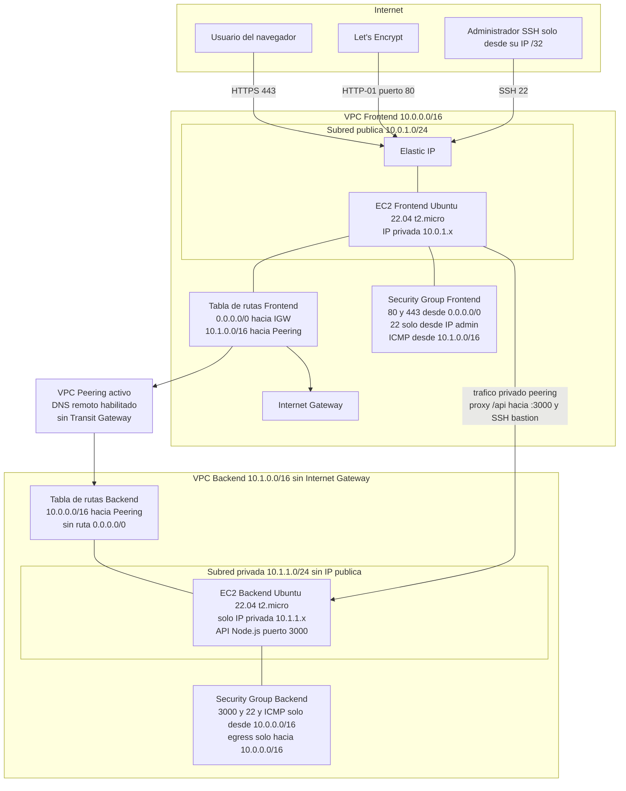
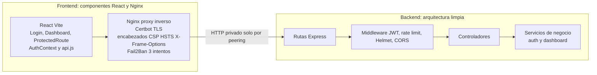
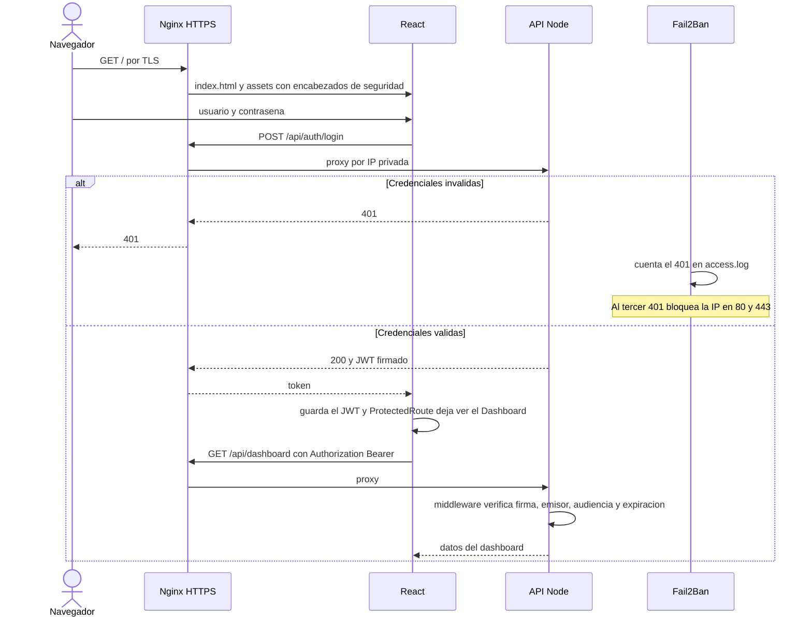

# Diagrama de arquitectura — Actividad 1 Zero Trust

Abrir este archivo en [Mermaid Live](https://mermaid.live) o en un visor de Markdown que renderice Mermaid, y exportar PNG o SVG para el reporte.

## 1. Infraestructura AWS, red y controles Zero Trust

## 2. Software en cada instancia y flujo de autenticación

## Decisiones que el diagrama debe dejar claras en el reporte

- El Backend no tiene IP pública ni ruta a Internet. La única entrada es el CIDR `10.0.0.0/16` por el peering.
- El navegador nunca habla con el puerto 3000. Habla con Nginx en el 443, y Nginx reenvía `/api` por la red privada.
- El JWT se valida en cada petición del dashboard. No basta con que el usuario haya iniciado sesión antes.
- Fail2Ban observa el log de Nginx, no confía en la IP que declara el cliente dentro de la aplicación.
- La interfaz es de componentes reutilizables. La API separa rutas, controladores y lógica de negocio.
