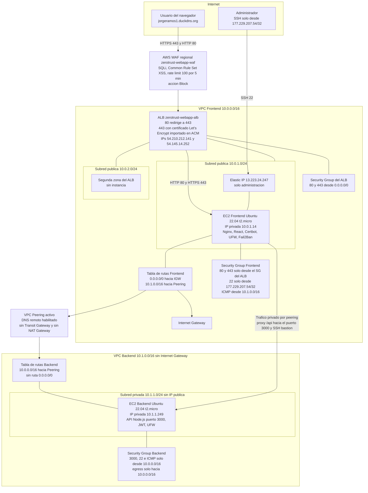
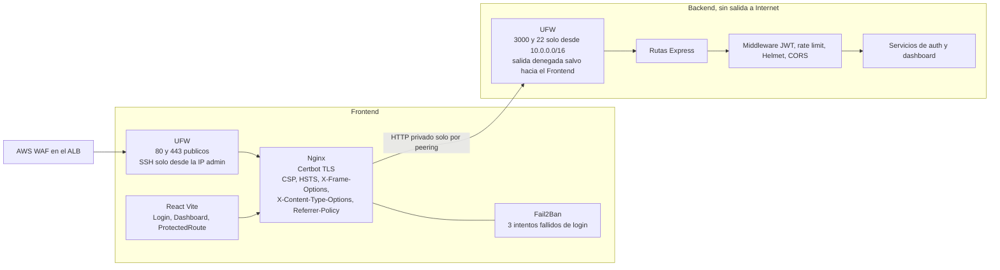
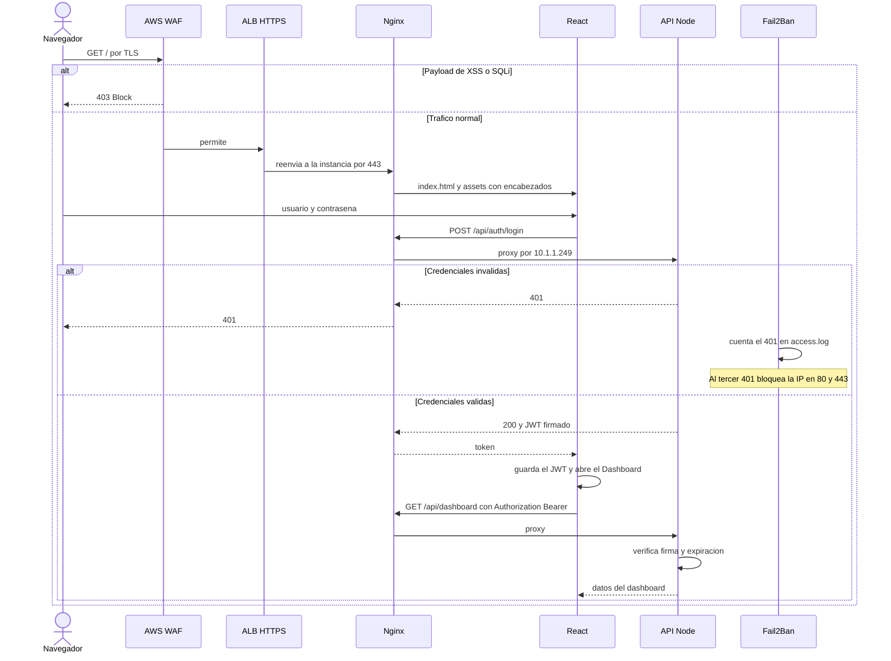

# Diagrama de arquitectura — Zero Trust

Abrir este archivo en [Mermaid Live](https://mermaid.live) o en un visor de Markdown que renderice Mermaid, y exportar PNG o SVG para el reporte.

El sitio público ya no entra por la Elastic IP. Entra por el Application Load Balancer, con AWS WAF delante. CloudFront no está en el diagrama porque el Learner Lab niega `cloudfront:CreateDistribution`.

## 1. Infraestructura AWS, red y controles Zero Trust

## 2. Software en cada instancia y flujo de autenticación

## Decisiones que el diagrama debe dejar claras en el reporte

- El punto de entrada público es el ALB. AWS WAF está asociado a ese balanceador, en alcance regional y en modo Block.
- DuckDNS solo admite un registro A. El dominio apunta a `54.210.212.141`, una IP del ALB. La otra IP del balanceador es `54.145.14.252`.
- La Elastic IP `13.223.24.247` no publica la web. Sirve para SSH del administrador. Los puertos 80 y 443 de la instancia solo aceptan el security group del ALB.
- El certificado lo emitió Certbot en Nginx. El ALB presenta ese mismo certificado, importado en ACM, porque DuckDNS no permite el CNAME de validación de un certificado nuevo de ACM.
- El Backend no tiene IP pública ni ruta a Internet. La API solo acepta el CIDR `10.0.0.0/16` por el peering, en el security group y en UFW.
- El navegador nunca habla con el puerto 3000. Habla con el ALB en el 443, Nginx reenvía `/api` por la red privada y el Backend responde solo hacia el Frontend.
- UFW está activo en los dos servidores y coincide con los security groups. En el Backend la salida también está denegada, salvo hacia la VPC del Frontend.
- El JWT se valida en cada petición del dashboard. Fail2Ban observa el log de Nginx.
